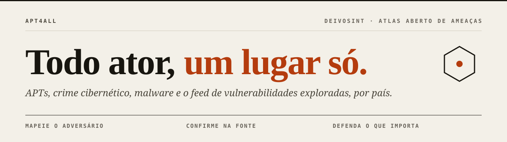

<div align="center">



# ◆ APT4ALL

**Every threat actor, one place.** An open, bilingual atlas of APT groups, cybercrime and malware,
with threat profiles by country and sector, curated resources and a learning path for CTI analysts.

`1.0 "War Room"` · DEIVOSINT · Português: [README.md](README.md)

**read the pattern · listen to the silence · take position and wait**

[](https://ridd1kulusc0d3r.github.io/apt4all/atlas/)
[](https://attack.mitre.org/)
[](LICENSE)
[](LICENSE-CONTEUDO.md)

</div>

---

> **Start here, just one thing:** open the [Atlas](https://ridd1kulusc0d3r.github.io/apt4all/atlas/) and click on any country.
> Then [START-HERE.md](START-HERE.md) takes you to the next step.

## Why it exists

One group has ten names: APT28 is Fancy Bear, Sofacy, Forest Blizzard, STRONTIUM, Sednit... Each vendor names it its own way, and analysts lose hours cross-checking the spreadsheet, MISP and ATT&CK. APT4ALL merges these open sources, resolves the aliases with an auditable rule and delivers everything on a map that answers three questions:

1. **Who is this actor?** (every name, attributed country, motivation, techniques, tools, operations, reports)
2. **Who attacks organizations like mine?** (profile by country and sector, with an ATT&CK Navigator layer)
3. **Where do I study this properly?** (186 curated resources and a 9-module learning path)

## What's inside

| Door | What it does | Where |
|---|---|---|
| 🗺️ **War-room Atlas** | Hex map by country, country dossier, actor card, ranking | [`docs/atlas/`](docs/atlas/) · [online](https://ridd1kulusc0d3r.github.io/apt4all/atlas/) |
| 🌊 **Flows and Network** | Sankey country → motive → tactic → technique; network of shared techniques; the same for tools of 92 ransomware gangs | [Atlas → Flows](https://ridd1kulusc0d3r.github.io/apt4all/atlas/#fluxos) · [Network](https://ridd1kulusc0d3r.github.io/apt4all/atlas/#rede) |
| 🎯 **Threat profile** | Country + sector → likely actors, techniques to cover, Navigator layer, TCE signal | [Atlas → Profile](https://ridd1kulusc0d3r.github.io/apt4all/atlas/#perfil) · [`ferramentas/tce/`](ferramentas/tce/) |
| 📡 **Vulnerability feed** | Vulnerabilities with confirmed exploitation (CISA KEV), linked to actors where public attribution exists, with Atom and JSON; refreshed weekly | [`docs/feed/`](docs/feed/) · [online](https://ridd1kulusc0d3r.github.io/apt4all/feed/) |
| 📚 **Resources** | 186 links in 21 categories, bilingual, legacy flagged, a filter for the original list, checked monthly | [RESOURCES.md](RESOURCES.md) · [online](https://ridd1kulusc0d3r.github.io/apt4all/recursos/) |
| 🧭 **Learning path** | 9 modules, from a group's name to a final dossier, each with one "do this now" action | [`trilha/`](trilha/README.en.md) |
| 🔗 **TCE bridge** | Takes the threat profile into whole-environment threat modeling | [`tce/`](tce/README.en.md) |
| 📄 **Browsable texts** | Learning path, templates, TCE analysis, sources and test report as pages with side menu and table of contents | [`docs/ler/`](docs/ler/) · [online](https://ridd1kulusc0d3r.github.io/apt4all/ler/index.html) |
| 📖 **Illustrated manual** | Step by step with annotated screens, for first-time users | [`docs/manual/`](docs/manual/) · [online](https://ridd1kulusc0d3r.github.io/apt4all/manual/) |

## The dataset in numbers

Run of 2026-10-13, generated by [`construir_dados.py`](ferramentas/atlas/construir_dados.py). Per-country detail in [`dados/gerados/resumo.md`](dados/gerados/resumo.md).

| | |
|---|---|
| Records read | 2,494 (sheet 411 · MISP 1,060 · ATT&CK 176 · EternalLiberty 847) |
| Actors after alias resolution | **1,355** |
| Aliases catalogued | 2,598 |
| Actors with an ATT&CK profile | 184 |
| Linked ATT&CK techniques | 498 |
| Linked public reports (APTnotes) | 412 |
| Ransomware Tool Matrix | 92 groups · 347 tools · 1,060 uses (39 linked to Atlas actors) |
| Countries with attributed actors | 43, plus the NATO / Five Eyes bloc |
| Largest attributed origins | China 289 · Russia 156 · Iran 82 · North Korea 25 |
| No attributed country | 638 (mostly cybercrime and hacktivism) |

## Run it on your computer (two clicks)

You only need Python 3.9 or newer. Nothing to `pip install`.

| System | Double-click |
|---|---|
| Windows | `iniciar-windows.bat` |
| macOS | `iniciar-mac.command` |
| Linux | `iniciar-linux.sh` |

The browser opens at `http://localhost:8765`. To stop, close the black terminal window. The [manual](docs/manual/index.html) shows every screen.

From the command line:

```bash
git clone https://github.com/Ridd1kulusC0d3r/apt4all && cd apt4all
python3 -m http.server 8765 --directory docs      # Atlas and resources
python3 ferramentas/tce/perfil_ameaca.py --pais "United States" --setor government --saida out/us-gov
```

## How the data stays alive

| When | What | Workflow |
|---|---|---|
| Every Monday, 06:00 UTC | Downloads MISP, ATT&CK, the sheet, EternalLiberty, APTnotes and the Ransomware Tool Matrix; rebuilds the Atlas and opens a PR | [`atualizar-dados.yml`](.github/workflows/atualizar-dados.yml) |
| 1st of each month | Checks the 186 links and opens an issue if one died | [`verificar-links.yml`](.github/workflows/verificar-links.yml) |
| Every push and PR | Runs the tests | [`testes.yml`](.github/workflows/testes.yml) |
| Every push to `main` | Publishes `docs/` to GitHub Pages | [`pages.yml`](.github/workflows/pages.yml) |

## Layout

```
apt4all/
├── docs/                    site (GitHub Pages)
│   ├── index.html           home page
│   ├── atlas/               War-room Atlas + atores.json, paises.json, mapa.json, ransomware.json
│   ├── recursos/            resource search
│   ├── ler/                 repository texts as HTML (generated from Markdown)
│   └── manual/              illustrated manual
├── ferramentas/
│   ├── atlas/               construir_dados.py (sources → dataset), mapa_hex.py (map)
│   ├── recursos/            verificar_links.py, gerar_listas.py
│   ├── ransomware/          construir_matriz.py (Ransomware Tool Matrix → ransomware.json)
│   ├── tce/                 perfil_ameaca.py (TCE bridge)
│   ├── site/                gerar_paginas.py (Markdown → docs/ler/)
│   └── manual/              capturar_telas.py (manual screenshots, optional)
├── recursos/recursos.json   single source for resources (edit here)
├── trilha/                  learning path, 9 modules
├── tce/                     TCE analysis and bridge usage
├── dados/                   raw (sources) and generated (summary, links)
├── testes/                  unittest tests (standard library only)
└── iniciar-*                two-click launchers
```

Folder and tool names are in Portuguese (the project's home language); every page and document has an English version.

## Responsible use

- **Attribution is a claim, not a fact.** APT4ALL collects what vendors and governments say, with the source of each data point. Confirm at the origin before citing.
- **No malware here.** Sample resources point to third-party repositories and carry a warning: isolated lab only.
- **Defensive level.** The learning path teaches reading, mapping, prioritizing and detecting. Attack procedures stay out.

## Ecosystem

| Project | Relation |
|---|---|
| [Cyber-Threat-Context-Modeling (TCE)](https://github.com/Ridd1kulusC0d3r/Cyber-Threat-Context-Modeling) | Whole-environment threat modeling; takes the APT4ALL profile as an intelligence signal |
| [TOCAIA OSINT Linux](https://github.com/Ridd1kulusC0d3r/TOCAIALinux) | OSINT distribution; same visual identity |

## Contribute, cite, license

- How to contribute: [CONTRIBUTING.en.md](CONTRIBUTING.en.md) (shortest path: edit `recursos/recursos.json` and open a PR)
- Sources and licenses for each dataset: [SOURCES.md](SOURCES.md)
- How to cite: [CITATION.cff](CITATION.cff)
- Code under [MIT](LICENSE); texts under [CC BY 4.0](LICENSE-CONTEUDO.md); third-party data under its original license

<div align="center"><sub>® MITRE ATT&CK is a registered trademark of The MITRE Corporation. APT4ALL is not affiliated with MITRE or with any vendor cited.</sub></div>
